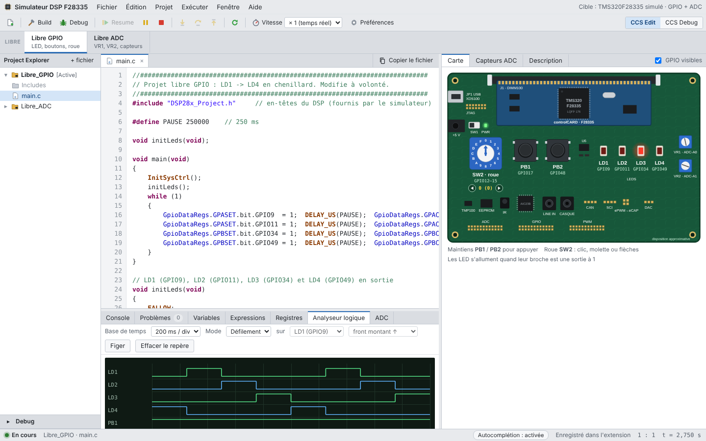
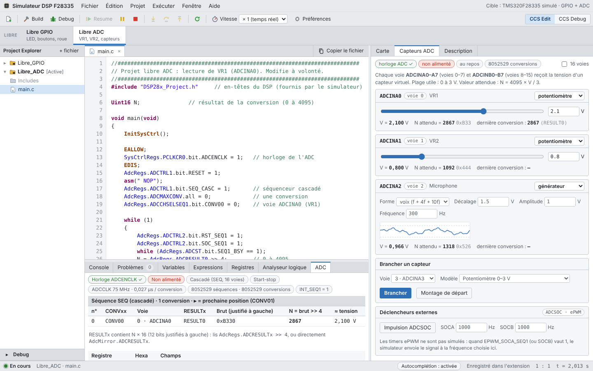

# Simulateur DSP F28335

Extension Chrome qui simule un DSP **TMS320F28335** pour s'entraîner à programmer ses périphériques en C, **sans carte** : éditeur et débogueur inspirés de Code Composer Studio, **GPIO**, **module ADC** et **capteurs virtuels**.

Tu écris ton programme, tu le lances, et la carte simulée réagit : les LED s'allument, les boutons se pressent à la souris, les capteurs se règlent au curseur et l'ADC convertit.



---

## Sommaire

- [Pourquoi ce projet](#pourquoi-ce-projet)
- [Fonctionnalités](#fonctionnalités)
- [Installation](#installation)
- [Prise en main](#prise-en-main)
- [Raccourcis clavier](#raccourcis-clavier)
- [Ce qui est simulé et ce qui ne l'est pas](#ce-qui-est-simulé-et-ce-qui-ne-lest-pas)
- [Données et confidentialité](#données-et-confidentialité)
- [Mettre à jour](#mettre-à-jour)
- [Signaler un problème](#signaler-un-problème)
- [Droits d'auteur](#droits-dauteur)

---

## Pourquoi ce projet

Pour apprendre à programmer un DSP, il faut d'habitude une carte de développement, Code Composer Studio et une salle de TP. Ce simulateur permet de s'entraîner n'importe où : préparer un TP, tester une idée, comprendre un registre ou trouver une erreur avant de passer sur la vraie carte.

Il n'est **pas** fait pour remplacer la carte. C'est un outil d'entraînement.

---

## Fonctionnalités

### Éditeur et débogueur
- Éditeur C avec coloration syntaxique et plusieurs fichiers `.c` / `.h` par projet.
- Messages d'erreur **en français**, avec une suggestion quand un nom de registre ou de champ est mal écrit (`GPAMUX1.bit.GPIO09` → « tu voulais dire GPIO9 ? »).
- Débogage comme dans CCS : arrêt au début de `main()`, points d'arrêt, pas à pas (*step into / over / return*), pile d'appels.
- Vues **Variables**, **Expressions** et **Registres**, mises à jour en direct.
- Vitesse du temps simulé réglable (temps réel, ralenti, accéléré).
- **Autocomplétion** des registres et de leurs champs, que tu peux activer ou désactiver.

### GPIO
- Registres `GpioCtrlRegs` et `GpioDataRegs` des ports A, B et C : `MUX`, `DIR`, `PUD`, `DAT`, `SET`, `CLEAR`, `TOGGLE`.
- Protection `EALLOW` / `EDIS` vérifiée.
- Carte simulée : 4 LED, 2 boutons poussoirs, roue codeuse 4 bits.
- **Analyseur logique** pour suivre les broches dans le temps.

### Module ADC
- Horloge (`SysCtrlRegs.PCLKCR0.bit.ADCENCLK`), `AdcRegs` et `AdcMirror`.
- Séquenceur **cascadé** (16 conversions) ou **double** (2 × 8).
- Modes **start-stop** et **continu**, `ADCMAXCONV`, `ADCCHSELSEQ1` à `4`.
- Drapeaux `SEQx_BSY`, `INT_SEQx`, `INT_SEQx_CLR`.
- Résultats **justifiés à gauche** comme sur le vrai composant : il faut écrire `ADCRESULTx >> 4`, ou lire `AdcMirror`.
- Durée de conversion calculée à partir de `ACQ_PS`, `CPS` et `ADCCLKPS`.
- Déclenchement logiciel, par la broche ADCSOC ou par SOCA / SOCB (ePWM, fréquence réglable).
- Réglages de réalisme : bruit, offset, arrondi ou troncature.

### Capteurs virtuels
Un capteur se branche sur chacune des 16 voies (ADCINA0 à A7, ADCINB0 à B7) :
- **potentiomètre** 0 à 3 V ;
- **capteur linéaire** `V = a·x + b` (courant, température, lumière, position, ou modèle personnalisé) ;
- **générateur** sinus, triangle, carré, dent de scie ;
- **microphone** : signal « voix » qui mélange trois fréquences (f, 4f et 10f).

Les deux potentiomètres de la carte sont reliés à ADCINA0 et ADCINA1.

### Vue ADC
- Registres décodés champ par champ, avec leur valeur en hexadécimal.
- Tableau de la séquence : pour chaque conversion, la voie, le registre `RESULTx` et la valeur.
- **Tracé** des dernières conversions ou du contenu d'un tableau de ton programme.
- **Mesure de la fréquence d'échantillonnage** : période moyenne entre deux conversions et Fe, utiles pour régler une temporisation.
- Calculatrice de quantification (tension ↔ N).

### Interface
- S'ouvre dans un onglet ou dans le **panneau latéral** de Chrome, à côté de ta documentation.
- Thème clair ou sombre.
- **Projets enregistrés automatiquement**, avec export / import pour les sauvegarder.
- Fonctionne **hors ligne**.



---

## Installation

L'extension n'est pas sur le Chrome Web Store. Elle s'installe en mode développeur, une seule fois, en environ deux minutes.

1. Télécharge le fichier `.zip` de la dernière version dans **[Releases](https://github.com/eliseeATIKPO/F28335-Simulator/releases)**.
2. Décompresse-le dans un dossier que tu garderas (par exemple `Documents/F28335-Simulator`). Chrome lit l'extension directement dans ce dossier : ne le supprime pas.
3. Dans Chrome, va à l'adresse `chrome://extensions`.
4. Active le **Mode développeur** (interrupteur en haut à droite).
5. Clique sur **Charger l'extension non empaquetée** et choisis le dossier qui contient `manifest.json`.
6. Épingle l'icône : pièce de puzzle ▸ punaise.

Navigateurs compatibles : Chrome ou Chromium 116 et plus récent, sous Windows, Linux ou macOS. En principe, les navigateurs basés sur Chromium (Edge, Brave) fonctionnent aussi, mais ils n'ont pas été testés.

---

## Prise en main

1. Clique sur l'icône de l'extension (ou `Alt+Maj+D`).
2. Ouvre un des projets **Libre** : la carte et les capteurs sont déjà branchés.
3. Écris ton code dans `main.c`.
4. **Debug** (`F11`) pour démarrer arrêté au début de `main()`, puis **Resume** (`F8`). Ou lance directement avec `Ctrl+Entrée`.
5. Observe le résultat : LED sur la carte, onglet **Capteurs ADC** à droite, onglet **ADC** et **Analyseur logique** en bas, variables dans **Expressions**.

Exemple minimal pour lire le potentiomètre VR1 :

```c
#include "DSP28x_Project.h"

Uint16 N;

void main(void)
{
    InitSysCtrl();

    EALLOW;
    SysCtrlRegs.PCLKCR0.bit.ADCENCLK = 1;   // horloge de l'ADC
    EDIS;
    AdcRegs.ADCTRL1.bit.RESET = 1;
    asm(" NOP");
    AdcRegs.ADCTRL1.bit.SEQ_CASC = 1;       // séquenceur cascadé
    AdcRegs.ADCMAXCONV.all = 0;             // une conversion
    AdcRegs.ADCCHSELSEQ1.bit.CONV00 = 0;    // voie ADCINA0 (VR1)

    while (1)
    {
        AdcRegs.ADCTRL2.bit.RST_SEQ1 = 1;
        AdcRegs.ADCTRL2.bit.SOC_SEQ1 = 1;
        while (AdcRegs.ADCST.bit.SEQ1_BSY == 1);
        N = AdcRegs.ADCRESULT0 >> 4;        // 0 à 4095
    }
}
```

Ajoute `N` dans l'onglet **Expressions** puis tourne VR1 : la valeur suit.

---

## Raccourcis clavier

| Action | Raccourci |
|---|---|
| Ouvrir le simulateur | `Alt+Maj+D` |
| Compiler et lancer | `Ctrl+Entrée` |
| Debug (arrêt au début de `main`) | `F11` |
| Resume | `F8` |
| Pas à pas : entrer / passer / sortir | `F5` / `F6` / `F7` |
| Ouvrir l'autocomplétion | `Ctrl+Espace` |
| Activer / désactiver l'autocomplétion | `Ctrl+Maj+Espace` |
| Préférences | `Ctrl+,` |

---

## Ce qui est simulé et ce qui ne l'est pas

Le simulateur **interprète** ton code C. Ce n'est pas un compilateur pour le vrai DSP et il ne programme pas de carte.

**Pris en charge :**
- variables, tableaux (1 et 2 dimensions), fonctions, `#define`, `#include` ;
- `if`, `switch`, `for`, `while`, `do … while` ;
- `printf` vers la console ;
- `DELAY_US()` et les fonctions d'initialisation courantes (`InitSysCtrl`, `InitGpio`…) ;
- temps simulé : environ 0,05 µs par instruction C, donc une boucle de temporisation a une durée.

**Pas pris en charge :**
- pointeurs, `struct`, `enum`, `typedef` ;
- routines d'interruption (PIE) : `EINT` est accepté mais sans effet ;
- timers ePWM et CPU Timers (les signaux SOCA / SOCB vers l'ADC sont en revanche simulés) ;
- autres périphériques (SCI, SPI, I2C, eCAN, eCAP, eQEP…).

Le timing est approximatif. Valide toujours ton programme sur la vraie carte.

---

## Données et confidentialité

- Tes projets sont enregistrés **dans l'extension, sur ton ordinateur**. Rien n'est envoyé sur Internet.
- **Désinstaller l'extension efface tes projets.** Pour les garder, va dans Préférences ▸ Données ▸ Exporter.

Permissions demandées et leur usage :

| Permission | Usage |
|---|---|
| `storage`, `unlimitedStorage` | enregistrer tes projets et préférences sur ton ordinateur |
| `sidePanel` | ouvrir le simulateur dans le panneau latéral |
| `contextMenus` | menu clic droit sur l'icône (onglet ou panneau latéral) |
| `clipboardWrite` | bouton « Copier le fichier » |

L'extension ne lit aucune page web et n'a accès à aucun site.

---

## Mettre à jour

1. Télécharge le nouveau `.zip` dans **Releases**.
2. Remplace le contenu de ton dossier par celui du nouveau zip.
3. Dans `chrome://extensions`, clique sur la flèche circulaire de l'extension.

Tes projets sont conservés.

---

## Signaler un problème

Ouvre une **[issue](https://github.com/eliseeATIKPO/F28335-Simulator/issues)** en indiquant :
- ce que tu attendais et ce qui s'est passé ;
- le code concerné, ou un exemple réduit qui reproduit le problème ;
- ta version de Chrome et ton système.

Un écart entre le simulateur et la vraie carte est un bug intéressant à signaler.

---

## Droits d'auteur

© 2026 Elisée Atikpo ([@eliseeATIKPO](https://github.com/eliseeATIKPO)). Tous droits réservés.

Le code est public pour être consulté et pour que l'extension puisse être installée et utilisée librement. Aucune licence n'est accordée pour le copier, le modifier ou le redistribuer sans autorisation. Pour toute demande, ouvre une issue.

*TMS320F28335, C2000 et Code Composer Studio sont des marques de Texas Instruments. Ce projet est indépendant et n'est ni affilié à Texas Instruments ni approuvé par cette société.*
